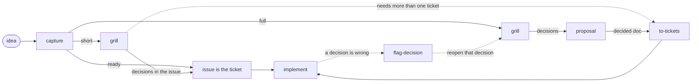

# dev-flow

Lightweight Claude Code skills for getting from an **idea** to **tickets an agent can implement**, with every design decision written down and linked to the tickets that build it.

It covers the part before the code: deciding what to build. Implementing the tickets is left to whatever you already use (Superpowers, Matt Pocock's skills, plain Claude Code). dev-flow comes back in only if the implementation shows a decision was wrong.

## The flow



1. **`capture`** turns the idea into one GitHub issue (Problem, Idea, Open questions) and picks the lightest path that fits:
   - **ready:** no open questions and no design needed, so the issue *is* the ticket;
   - **short:** a few questions to settle, so the decisions go straight into the issue;
   - **full:** a new interface, a cross-cutting change, or more than about three tickets, so it gets a design doc.
2. **`grill`** settles the open questions with you in rounds. Each round asks every question that can be asked now, each with a recommended answer, so "yes" accepts them all. Each answer becomes a numbered decision, `### D1: …`.
3. **`proposal`** (full path only) writes the decisions up as `docs/proposals/<name>.md` and **fact-checks every claim** in it against the code, the docs or a live probe. A wrong claim reopens the decision it supports, and the doc can't merge until its status is exactly `decided`. Use it instead of `/code-review` on a design-doc PR.
4. **`to-tickets`** slices a decided doc, or a short-path issue that needs more than one ticket, into vertical, tracer-bullet tickets. Each ticket names the decisions it implements and the tickets that block it. Nothing is published until you approve the breakdown.
5. **`flag-decision`** is for the agent implementing a ticket. If the work shows a decision is wrong, impossible or contradicted by the code, it stops, posts the evidence, labels the ticket `needs-decision`, and hands the decision back to `grill`, so nothing gets quietly redesigned inside a ticket.

Every step that writes to GitHub shows you the draft first and waits for your yes.

## What the artefacts look like

**Decisions** are headings with IDs that never change once given: `### D3: Codex jots get "can't tell" in v1`. When one is revised, it keeps its ID, and the old text moves into a `<details>` "Superseded" block with the reason.

**Tickets** start with three lines that link them back:

```markdown
Implements: D2, D4 — docs/proposals/jot-status-check.md
Blocked by: #82
Parent: #78
```

**Labels:** `ready-for-agent` means an agent can start the ticket now. `needs-decision` means `flag-decision` has put it on hold until `grill` settles the decision.

**A proposal's status** is exactly one of `decided`, `decided, M facts unchecked`, `N open` or `N open, M facts unchecked`. Only `decided` can merge or be sliced.

## Example

kacxx/aside-jot#78, "is a jot done yet?", went the full path:
1. The proposal (aside-jot#79) recorded D1–D5. Its fact-check found that D3 rested on a false premise (Codex jots *do* have a transcript), and `grill` settled D3 again.
2. `to-tickets` sliced it into five tickets (aside-jot#82–#86).
3. All five PRs were open about 70 minutes after the tickets were published.

The timings are in [`docs/path-tuning.md`](docs/path-tuning.md#outcomes). dev-flow itself was designed the same way, by hand, in [#1](https://github.com/kacxx/dev-flow/issues/1); its decisions are in [`docs/proposals/idea-to-tickets.md`](docs/proposals/idea-to-tickets.md).

## Install

**Mac and Windows (Claude Code plugin):**

```bash
claude plugin marketplace add kacxx/dev-flow
```

```bash
claude plugin install dev-flow@dev-flow
```

To update after a new version (the version is in `.claude-plugin/plugin.json`), run `claude plugin marketplace update dev-flow`, then `claude plugin update dev-flow@dev-flow`, and restart Claude Code.

**In each project that uses it:** add the one-line pointer from [`skills/flag-decision/SKILL.md`](skills/flag-decision/SKILL.md#the-claudemd-pointer) to the project's `CLAUDE.md` (or the `AGENTS.md` it imports). It makes an implementing agent stop and flag a wrong decision instead of redesigning around it, even an agent without the plugin. `to-tickets` checks for the line and offers it if it's missing.

**Phone (Claude Code cloud sessions from the Code tab):** these don't load plugins, but they do load claude.ai account skills. The phone set is `capture`, `grill` and `flag-decision`:
1. Build the ZIPs with `python3 -I scripts/build_account_skills.py` (use `python` on Windows, where `python3` is often the Microsoft Store stub). This writes `dist/account-skills/<name>.zip` after checking each skill's name, description and frontmatter.
2. Upload each ZIP on claude.ai under **Customize → Skills** (code execution must be on).
3. Re-upload after a skill changes: account skills don't follow plugin versions.

Phone sessions start on a fresh `claude/…` branch, and the local `main` can be behind. Bring the branch you need up to date first: `git fetch origin && git checkout BRANCH && git merge --ff-only origin/BRANCH`.

The skills use `gh api` (REST) everywhere, because `gh issue` and `gh pr` go through GraphQL, which fails in cloud sessions. Where cloud sessions block GitHub search, each skill falls back to listing issues and filtering them.

## Status

Beta. All five skills are built and have been run for real: on dev-flow itself, on aside-jot, natively on Windows, and from the phone. Not tried live yet: `flag-decision` in a real implementation run, and WSL. Known gap: nothing adds `ready-for-agent` to a blocked ticket when its blockers close ([#31](https://github.com/kacxx/dev-flow/issues/31)).

## Developing

- **Layout:**
  - `skills/<name>/SKILL.md`, one folder per skill;
  - `evals/<case>/` for the `claude plugin eval` cases, with scores in [`evals/RESULTS.md`](evals/RESULTS.md);
  - `scripts/` for the ZIP builder and the test runner;
  - `docs/` for the proposal and the path-tuning log.
- **Tests:** `python3 -I scripts/run_tests.py` (`python` on Windows) runs every `test_*.py`. That includes a frontmatter check on every skill, and the jq filters in the skills' search fallbacks, run as written. CI runs the same command on every PR and on pushes to `main`, on Ubuntu and Windows, with and without PyYAML.
- **Releases:** bump `version` in `.claude-plugin/plugin.json` on every change, because installed plugins only update when it changes. If `capture`, `grill` or `flag-decision` changed, rebuild and re-upload their ZIPs.
- **After each real run:** add a row to [`docs/path-tuning.md`](docs/path-tuning.md), and turn what was clumsy into an issue (`capture` works for that too).

## Credits

`grill` and `to-tickets` are adapted from [Matt Pocock's skills](https://github.com/mattpocock/skills) (MIT); see [`NOTICE`](NOTICE). dev-flow is MIT licensed ([`LICENSE`](LICENSE)).
